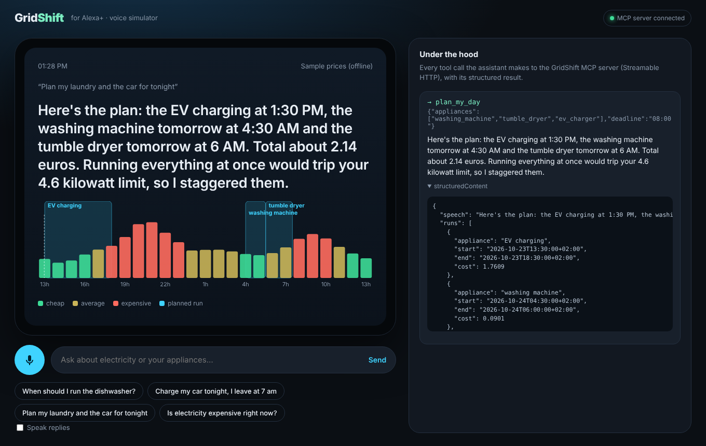
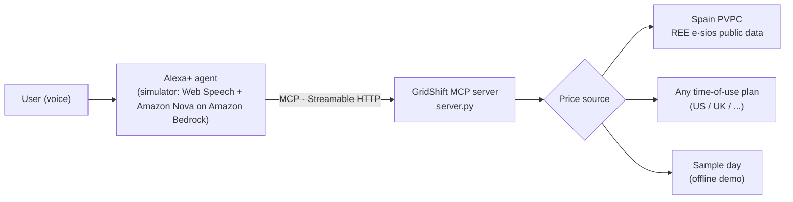

# GridShift — the electricity-price copilot for Alexa+

> "Alexa, when should I run the dishwasher?"
> "Start the dishwasher tomorrow at 3 AM. It will cost about 9 cents instead of 25 cents if you start it right away. That's 64 percent less."

Millions of homes now pay a different electricity price every hour (Spain's PVPC regulated tariff, UK Agile, US time-of-use plans). The same laundry load can cost two to three times more at 9 PM than at 3 AM, but nobody checks a price chart before pressing *Start*. GridShift is an **MCP server for Alexa+** that turns hourly prices into one spoken answer: *when* to run each appliance, *how much* it saves, and a plan that never trips the home's contracted power limit.

Built for the **Alexa+ track** of *Build, Ship, Shape: Amazon Developer Hackathon* (+ AWS Builder mini challenge: Amazon Bedrock / Amazon Nova).

## What it does

| Tool | Ask Alexa | What GridShift does |
|---|---|---|
| `price_outlook` | "Is electricity expensive right now?" | Current price and level (cheap / average / expensive), cheapest 3-hour stretch in the next 24 h, priciest hour to avoid, hourly series for screens |
| `find_best_time` | "Charge my car before 7 am" | Cheapest start (15-minute resolution) inside the user's window, cost vs. starting now, % saved |
| `plan_my_day` | "Plan my laundry and the car tonight" | Schedules several appliances at their cheapest times while keeping total draw under the power limit (4.6 kW default). The dryer runs within 3 h after the washer. Monthly savings estimate |

Plus a resource (`gridshift://appliances`, typical run time and power of 8 appliances) and a prompt (`energy_briefing`).

**Designed for voice.** Every tool returns a `speech` field — one to three sentences ready to be said aloud ("tomorrow at 2 AM", "8 cents", never ISO timestamps) — alongside typed `structuredContent` (with `outputSchema`) for agents and for devices with a screen like Echo Show.



## Architecture



- **MCP server** (`server.py`): official MCP Python SDK v2 (`MCPServer`), Streamable HTTP at `/mcp`. Negotiates protocol **2026-07-28** and also accepts **2025-11-25** clients (tested). All tools carry annotations (`readOnlyHint`, `idempotentHint`, `openWorldHint`) and typed output schemas.
- **Planner** (`gridshift/planner.py`): exact cost integration over hourly prices, 15-minute start grid, greedy power-aware scheduler, DST-safe (25-hour days included).
- **Prices** (`gridshift/prices.py`): Spain PVPC from REE's public e·sios daily file — no API key; parsing matches [aiopvpc](https://github.com/azogue/aiopvpc), the library behind Home Assistant's PVPC integration (cross-checked in tests). Falls back to a clearly labelled sample day if the live source is unreachable.
- **Alexa+ simulator** (`demo/`): FastAPI + a voice web UI. The agent is **Amazon Nova Pro via the Amazon Bedrock Converse API**; MCP tool definitions are passed to Bedrock as-is and every tool call goes to the MCP server over HTTP. An "Under the hood" panel shows each call and its structured result; the price chart highlights the planned runs.

## Run it

Requires Python 3.11+.

```bash
pip install -r requirements.txt

# 1) MCP server -> http://localhost:8000/mcp
python server.py
#    offline / outside Spain:  GRIDSHIFT_TARIFF=sample python server.py

# 2) Inspect it with the official MCP Inspector (no LLM needed)
npx @modelcontextprotocol/inspector
#    Transport: Streamable HTTP · URL: http://localhost:8000/mcp

# 3) Alexa+ simulator -> http://localhost:8080 (Chrome for voice input)
#    needs AWS credentials with Amazon Bedrock access (aws configure)
python demo/app.py
```

Tests: `pytest -q`

### Configuration

| Variable | Default | Meaning |
|---|---|---|
| `GRIDSHIFT_TARIFF` | `esios` | `esios` (Spain PVPC, live), `tou` (time-of-use plan), `sample` (offline) |
| `GRIDSHIFT_TOU` | `0-7:0.12,7-16:0.22,16-21:0.45,21-24:0.22` | Hour ranges and price per kWh for `tou` |
| `GRIDSHIFT_CURRENCY` | `USD` | Currency for `tou` |
| `GRIDSHIFT_TZ` | `Europe/Madrid` | Household time zone |
| `GRIDSHIFT_POWER_LIMIT_KW` | `4.6` | Contracted power limit |
| `GRIDSHIFT_BASE_LOAD_KW` | `0.4` | Always-on load (fridge, router) |
| `PORT` / `HOST` | `8000` / `0.0.0.0` | MCP server address |
| `MCP_URL` | `http://localhost:8000/mcp` | Simulator → MCP server |
| `BEDROCK_MODEL_ID` | `us.amazon.nova-pro-v1:0` | Any Bedrock model with tool use |
| `AWS_REGION` | `us-east-1` | Bedrock region (EU: `eu-west-1` with `eu.amazon.nova-pro-v1:0`) |

Example for a US time-of-use plan:
`GRIDSHIFT_TARIFF=tou GRIDSHIFT_TZ=America/Los_Angeles GRIDSHIFT_TOU="0-16:0.31,16-21:0.49,21-24:0.31" python server.py`

### Expose it to a remote agent

The server is stateless with respect to users and read-only, so any HTTPS front works:

```bash
cloudflared tunnel --url http://localhost:8000     # -> https://<random>.trycloudflare.com/mcp
```

## What's next

- Act, not just advise: start smart plugs and EV chargers through Alexa+ routines at the planned time.
- Proactive "cheap hour starting now" notifications, solar and home-battery awareness, CO₂ intensity.
- More live markets (UK Agile, US real-time pricing, Nordics) behind the same three tools.

## License

MIT. Price data for Spain: Red Eléctrica de España (e·sios).
